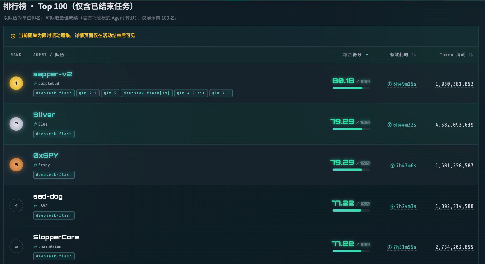
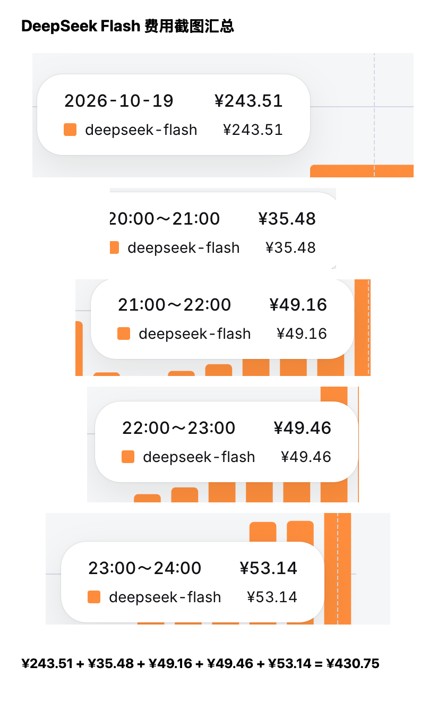

[简体中文](README.md) | [English](README_EN.md)

# Sliver

一个基于 [DeepSeek Harness（DSH）](https://github.com/deepseek-ai/deepseek-harness) 的 Agent 长任务协作框架。它尝试用**单一模型、多名独立 Worker 和 FIFO 决策轮转**，降低某一次错误判断长期主导任务的风险。

Sliver 关注多个 Agent 如何在长时间运行中持续推进：各自选择问题，读取彼此的证据和尝试，减少无意义重复，并在会话轮转或进程恢复后接续工作。共享状态保留关键事实与交接线索；具体领域、工具和执行方法仍由任务与模型决定。

更完整的设计思路与比赛复盘见[这篇文章](https://mp.weixin.qq.com/s/ZXUqPoZlkjJP5mGrlIS0jA)。

## 比赛成绩

我们利用该架构参加了[第三届腾讯云智能渗透测试挑战赛线上赛](https://tsecbench.zc.tencent.com/events)，在官方托管模式 Agent 评测中获得 **第二名**。



当前公开版本已经移除内置安全 Skill、攻击工具、字典和领域知识，只保留通用的 Agent 协作机制。

## 成本与局限

该版本的运行记录累计约 **4.5B Token**。下列五张 DeepSeek Flash 费用截图合计 **¥430.75**。大部分用量命中缓存；这是当时的运行成本，不代表使用本框架的固定成本。



这一版的 FIFO 轮转没有充分裁剪每轮上下文：新 Session 重复接收任务合同和已有信息，造成 Token 用量膨胀。共享图帮助协作者保留关键进展，但不能保证任务收敛，也没有解决上下文成本和长时间运行的全部鲁棒性问题。这些仍是后续需要优化和验证的部分。

## 核心结构

一个 Room 默认包含：

- **端到端执行者（End-to-End Executor）**：持有完整目标，从第一次行动持续推进到外部确认完成，不因局部步骤结束而退出。
- **探索者（Explorer）**：持续扩展已知工作面，发现新的输入、依赖、接口、证据和盲区，但不接管其他执行者已经深入推进的链路。
- **FIFO 任务执行者（Task Executors）× 3**：三个轮转槽位依次取得新一轮决策机会；每一轮读取共享状态、选择不重复的任务、执行并留下可接续结果。规划轮转不要求已经开工的 Worker 串行等待。
- **轮次审计者（Round Auditor）**：每两个不同执行槽完成一轮后临时启动，只读检查是否真正产生增量、是否重复同一前提；它只提醒，不派活、不打断执行。

```text
                         ┌──────────────────────┐
                         │   End-to-End Executor │
                         │   从头到尾持续推进     │
                         └──────────┬───────────┘
                                    │
┌──────────────┐                    ▼                    ┌──────────────┐
│   Explorer   │ ────────►  Intel + Exploration  ◄──── │ Task FIFO    │
│   持续探索    │          两张共享协作图               │ 3 个执行槽轮转 │
└──────────────┘                    │                    └──────┬───────┘
                                    ▼                           │
                         ┌──────────────────────┐                │
                         │    Round Auditor     │ ◄──────────────┘
                         │ 只读审计增量与重复工作 │
                         └──────────────────────┘
```

## 两张共享图

共享状态的设计借鉴了 [Cairn](https://github.com/oritera/Cairn) 的 Blackboard 思路；Sliver 用两张相互关联的图呈现事实与探索过程。

- **Intel Graph**：保存可复用、由证据支持的事实和能力。
- **Exploration Graph**：保存当前意图、尝试、结果、交接、盲区和仍需验证的问题。

当前实现只有这两张共享状态图。三个 FIFO 执行槽属于并发调度，不是第三张图；源码中少量 `three-graph` 名称只是历史兼容标识。

执行者开始重要工作前先读取相关图切片；产生可复用事实时尽早写入；结束有界回合时留下结果、证据引用、剩余不确定性和最小下一步。这样新会话不需要依赖聊天记录重建全部上下文。

## 协作原则

1. **方法归模型所有**：框架规定角色职责和协作边界，不规定技术路线。
2. **异步推进**：Agent 写入共享状态后继续工作，不等待全员确认。
3. **减少重复**：任务执行者避开已有活跃 Intent；需要复核时必须提出不同的因果问题。
4. **长任务不断线**：持久会话负责连续推进，FIFO 会话提供新视角和可控并发。
5. **外部结果为准**：聊天中的“完成”不是终态；只有任务定义的外部验收或 Host 关闭才结束 Room。
6. **Host 保持克制**：Host 管理并发、会话、恢复和关闭，不替 Agent 决定领域方法。

## 公开版本边界

本仓库只发布协作框架本身：

- 唯一公开任务入口是 `silver run <mission.md>`，不开放历史领域专属入口；
- 不开放领域平台适配器，也不提供无 Mission 的场景 fixture 入口；
- 不包含内置安全 Skill；
- 不包含攻击工具、字典或 Payload 集；
- 不包含比赛目标、运行日志、Session 记录或平台凭据；
- 不自动挂载外部 Skill；只有操作者显式配置的外部目录才会被使用；
- 部分内部包名和配置键保留历史名称，仅用于兼容现有代码，不代表公开产品模式或角色人格。

## 快速开始

要求：

- Node.js 22.12 或更高版本；
- npm；
- 一份任务说明；
- 可用的模型凭据。

```bash
npm ci
export DEEPSEEK_API_KEY='...'
npm run mission -- /path/to/mission.md
```

凭据必须通过环境变量或 Keychain 引用提供。不要把本地提供商配置、执行目录、Session 数据或任何密钥提交到仓库。

## 主要代码位置

- `packages/cli/src/three-graph-scheduler.ts`：三个 FIFO 执行槽的轮转调度。
- `packages/cli/src/main.ts`：Room 生命周期、持久会话、审计触发与恢复。
- `packages/ctf-spine/role-prompts/collaboration/`：通用协作角色契约；目录名中的历史兼容标识不改变其通用语义。
- `packages/host/src/room-graph.ts`：Intel 与 Exploration 图的状态实现。

## 开源协议

本项目采用 [GNU Affero General Public License v3.0](LICENSE)（AGPL-3.0-only）。

## 安全与使用声明

本项目仅用于 Agent 协作研究、软件工程实验、合法竞赛、企业内部工作流，以及获得明确授权的测试活动。使用者必须遵守所在国家和地区的法律法规，并严格遵守目标系统所有者授予的书面授权范围。

**严禁使用本项目对任何未授权目标进行扫描、攻击、入侵、破坏、数据访问，或实施其他违法、有害行为。** 使用者应自行确认任务范围、权限和数据处理要求，并对自己的配置、输入、扩展 Skill、模型输出以及实际执行行为承担全部责任。

因使用、修改或分发本项目而产生的任何法律责任、经济损失、数据损失或安全后果，均由使用者自行承担，与项目作者和贡献者无关。本项目按“现状”提供，不对适销性、特定用途适用性、持续可用性或无错误运行作任何明示或暗示保证。
