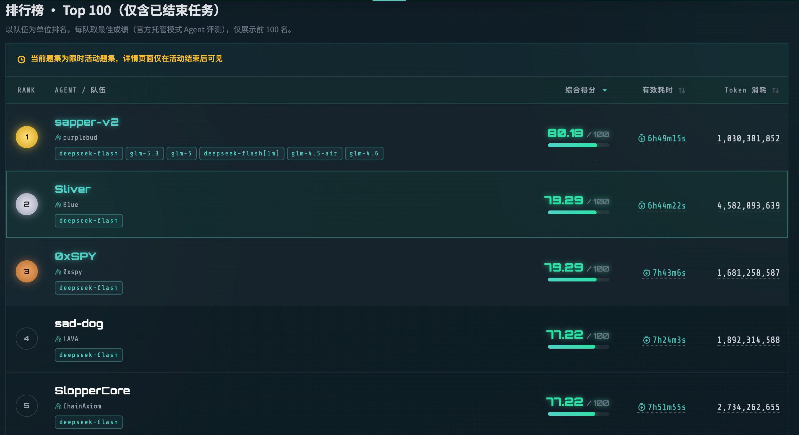
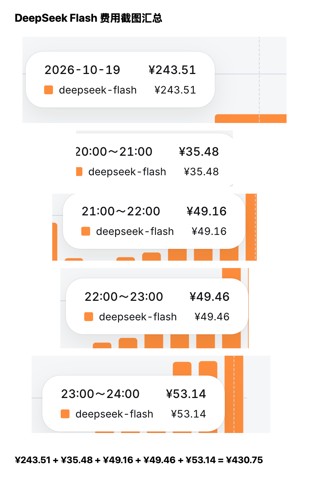

[简体中文](README.md) | [English](README_EN.md)

# Sliver

An Agent collaboration framework for long-running tasks, built on [DeepSeek Harness (DSH)](https://github.com/deepseek-ai/deepseek-harness).

It explores how **multiple independent Workers using one model and a FIFO decision cycle** can reduce the impact of a single mistaken decision dominating a task.

Sliver helps Agents keep working over time: each chooses a problem, reads others' evidence and attempts, avoids redundant work, and picks up where a previous session or process left off.

Shared state preserves important facts and handoffs. The task and model determine the domain, tools, and methods.

For the design rationale and competition retrospective, see [this article (in Chinese)](https://mp.weixin.qq.com/s/ZXUqPoZlkjJP5mGrlIS0jA).

## Competition result

This architecture was used in the [Third Tencent Cloud Intelligent Penetration Testing Challenge online competition](https://tsecbench.zc.tencent.com/events), where it placed **second** in the official hosted Agent evaluation.



The public release removes built-in security Skills, offensive tools, wordlists, and domain knowledge. It retains the general Agent collaboration mechanisms.

## Cost and current limitations

The recorded runs of this version used approximately **4.5 billion tokens**. The five DeepSeek Flash cost screenshots below total **CNY 430.75**. Most token usage hit the cache. These figures describe those runs, not a fixed cost of using the framework.



This version did not trim context sufficiently during FIFO rotation. New Sessions repeatedly received the task contract and earlier information, driving token usage up.

The shared graphs preserve important progress, but they do not guarantee convergence or fully solve context cost and long-running reliability. These remain areas for improvement and validation.

## Core structure

A Room contains these roles by default:

- **End-to-End Executor**: owns the complete goal and keeps working until the externally confirmed outcome is reached. It does not stop after a local step.
- **Explorer**: continuously expands the known work surface by finding inputs, dependencies, interfaces, evidence, and gaps. It does not take over a chain another executor is pursuing.
- **FIFO Task Executors × 3**: three rotating slots take turns choosing the next task. Each reads shared state, avoids duplicate work, executes, and leaves a handoff. Active Workers may execute in parallel.
- **Round Auditor**: starts temporarily after two distinct slots finish a turn. It reads progress and repeated work, then offers a reminder. It does not assign tasks or interrupt execution.

```text
                         ┌──────────────────────┐
                         │ End-to-End Executor  │
                         │ Continuous progress  │
                         └──────────┬───────────┘
                                    │
┌──────────────┐                    ▼                    ┌──────────────┐
│   Explorer   │ ────────►  Intel + Exploration  ◄──── │  Task FIFO   │
│ Broad search │          Two shared state views       │ 3 task slots │
└──────────────┘                    │                    └──────┬───────┘
                                    ▼                           │
                         ┌──────────────────────┐                │
                         │    Round Auditor     │ ◄──────────────┘
                         │ Read-only reminders  │
                         └──────────────────────┘
```

## Two shared graphs

Sliver organizes shared state into two related graphs for reusable facts and the exploration process.

- **Intel Graph** holds reusable, evidence-backed facts and capabilities.
- **Exploration Graph** holds current Intents, attempts, results, handoffs, blind spots, and open questions.

The implementation has only these two shared state graphs. The three FIFO slots are a scheduling mechanism, not a third graph. A few `three-graph` names remain in the source for historical compatibility.

Before starting substantial work, an executor reads the relevant graph slices. It records reusable facts as they emerge.

At the end of a bounded turn, it leaves the result, evidence references, remaining uncertainty, and a minimal next step. A new Session can continue without reconstructing everything from chat history.

## Collaboration principles

1. **Methods belong to the model**: the framework defines roles and collaboration boundaries, not a technical route.
2. **Asynchronous progress**: Agents continue after writing shared state; they do not wait for everyone to acknowledge it.
3. **Less duplication**: Task Executors avoid active Intents. A recheck needs a distinct causal question.
4. **Continuity**: persistent Sessions maintain long-running work; FIFO Sessions bring fresh perspectives and bounded concurrency.
5. **External outcomes are authoritative**: saying “done” in chat does not complete a Room. Its defined external acceptance or Host closeout does.
6. **A restrained Host**: the Host manages concurrency, Sessions, recovery, and closeout without choosing domain methods for Agents.

## Scope of the public release

This repository publishes the collaboration framework:

- Its public task entry point is `silver run <mission.md>`; historical domain-specific entries are not exposed.
- It does not expose domain platform adapters or a scenario fixture entry without a Mission.
- It contains no built-in security Skills, offensive tools, wordlists, or payload collections.
- It contains no competition targets, run logs, Session records, or platform credentials.
- It does not automatically mount external Skills. Operators must explicitly configure any external Skill directory.
- Some internal package names and configuration keys retain historical names for compatibility. They do not define the public product mode or role personas.

## Quick start

Requirements:

- Node.js 22.12 or newer;
- npm;
- a task brief;
- valid model credentials.

```bash
npm ci
export DEEPSEEK_API_KEY='...'
npm run mission -- /path/to/mission.md
```

Provide credentials through environment variables or Keychain references. Do not commit local provider configuration, execution directories, Session data, or secrets.

## Main code locations

- `packages/cli/src/three-graph-scheduler.ts`: rotation of the three FIFO task slots.
- `packages/cli/src/main.ts`: Room lifecycle, persistent Sessions, Auditor triggers, and recovery.
- `packages/ctf-spine/role-prompts/collaboration/`: general collaboration role contracts. Historical directory names do not change their general purpose.
- `packages/host/src/room-graph.ts`: state for the Intel and Exploration graphs.

## License

This project is licensed under the [GNU Affero General Public License v3.0](LICENSE) (AGPL-3.0-only).

## Safety and use

This project is intended for Agent collaboration research, software engineering experiments, lawful competitions, internal enterprise workflows, and explicitly authorized testing.

Users must follow applicable laws and the written scope granted by system owners.

**Do not use this project to scan, attack, access, or disrupt any unauthorized target, or for other unlawful or harmful activity.**

Users are responsible for their configuration, inputs, external Skills, model outputs, and resulting actions.

Users bear responsibility for consequences arising from their use, modification, or distribution of this project.

The authors and contributors accept no responsibility for resulting legal liability, financial loss, data loss, or security harm.

The project is provided “as is,” without express or implied warranties of merchantability, fitness for a particular purpose, continued availability, or error-free operation.
